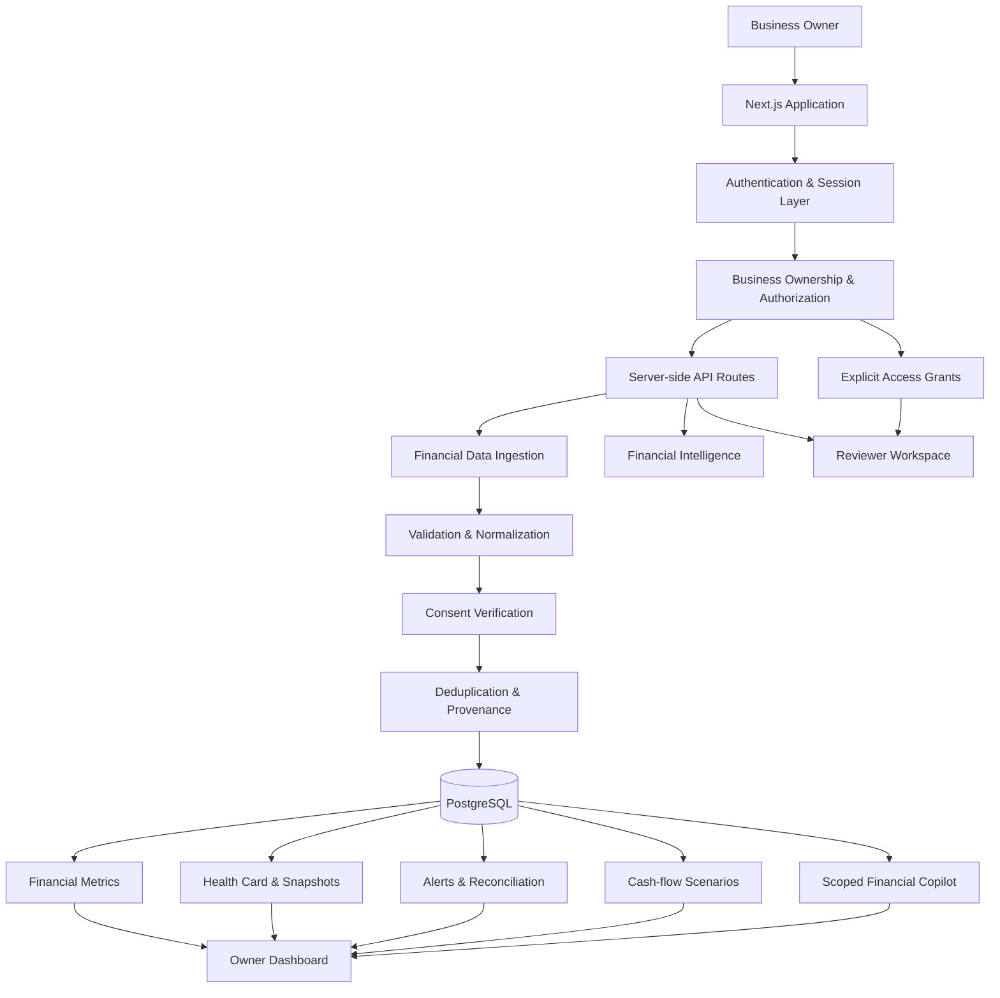
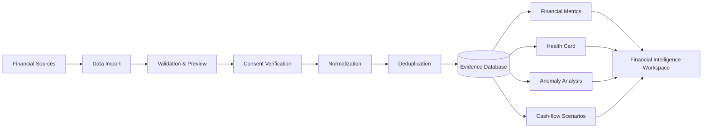

# 💸 FinesseAI
### Financial Intelligence. Greater Clarity. Stronger MSMEs.

<p align="center">
  <strong>An evidence-driven financial intelligence platform built to make MSME financial health more transparent, understandable, and actionable.</strong>
</p>

<p align="center">
  
  
  
  
  
</p>

<p align="center">
  <a href="#overview">Overview</a> •
  <a href="#architecture">Architecture</a> •
  <a href="#features">Features</a> •
  <a href="#technology-stack">Tech Stack</a> •
  <a href="#getting-started">Getting Started</a> •
  <a href="#documentation">Documentation</a>
</p>

---
<a name="overview"></a>
## ✨ Overview

**Financial information shouldn't be complicated. Understanding it shouldn't be a privilege.**

Micro, Small and Medium Enterprises (MSMEs) are the backbone of India's economy. Yet, many businesses struggle to translate their financial records into meaningful insights, assess their cash-flow position, or present their financial performance in a structured and understandable manner.

FinesseAI addresses this gap by bringing financial evidence, explainable analytics, and intelligent decision-support tools together in one platform.

Rather than relying on a single financial indicator, FinesseAI organizes information from multiple financial sources, validates and reconciles records, and transforms them into a structured picture of business financial health.

### Our approach

- **Understand:** Consolidate financial evidence from different sources into one workspace.
- **Analyze:** Identify financial patterns, anomalies, and potential cash-flow concerns.
- **Explain:** Translate financial observations into understandable insights.
- **Improve:** Help business owners explore scenarios and make informed decisions.
- **Collaborate:** Enable explicitly authorized reviewers to examine shared financial evidence.

FinesseAI aims to bridge the gap between raw financial data and actionable financial understanding.

## 🎯 The Problem

Traditional financial assessment often depends on fragmented information, manually maintained records, and financial indicators that are difficult for small business owners to interpret.

This creates three major challenges:

| Challenge | FinesseAI's Approach |
|---|---|
| Fragmented financial information | Consolidated financial evidence workspace |
| Limited financial visibility | Explainable financial metrics and Health Cards |
| Difficult financial planning | Cash-flow analysis, alerts and scenario simulations |
| Lack of transparent collaboration | Permission-controlled reviewer workspace |

The objective is not simply to generate another financial score. It is to make the underlying financial evidence understandable and useful.

<a name="architecture"></a>
## 🏗️ System Architecture

FinesseAI follows a modular Next.js architecture with a PostgreSQL-backed data layer. Its implementation emphasizes explicit authorization, validated financial imports, data provenance, and controlled access to business records.

### High-level architecture



### Architectural principles

**1. Separation of responsibilities**

The application separates user-facing interfaces, server-side operations, financial analysis, and persistent data management.

**2. Database-backed integrity**

PostgreSQL provides persistent storage, relational constraints, transaction handling, and ownership enforcement.

**3. Explicit authorization**

Business ownership and reviewer access are checked on the server. Possessing a reviewer role does not automatically grant access to business records.

**4. Evidence-driven analysis**

Financial observations are derived from stored and validated evidence rather than relying on unverified assumptions.

**5. Controlled decision support**

Financial scenarios and lending simulations remain illustrative. They do not automatically initiate real financial transactions or loan applications.

## ⚙️ How It Works

FinesseAI follows an evidence-to-intelligence workflow.



### Processing pipeline

1. **Data collection:** Business owners import supported financial records, including bank statements and alternate financial evidence.
2. **Validation:** Uploaded records undergo structural validation, parsing, and preview checks.
3. **Consent management:** Explicit and versioned consent governs the processing and availability of financial evidence.
4. **Normalization:** Financial records are converted into structured representations.
5. **Deduplication:** Duplicate records are identified using account and record fingerprints.
6. **Analysis:** Stored evidence is used to generate financial metrics, descriptive Health Cards, alerts, and scenarios.
7. **Presentation:** Business owners receive an organized financial intelligence workspace.

<a name="features"></a>
## 🚀 Features

### Financial Data Management

- Bank statement CSV import and preview.
- Invoice, electricity, and GST-related CSV imports.
- Financial record validation and normalization.
- Duplicate detection and prevention.
- Source-level provenance tracking.
- Import history and saved preview restoration.
- Explicit consent management and revocation.
- Owner-scoped financial data export and deletion.

### Financial Health Intelligence

- Explainable financial Health Cards.
- Versioned financial snapshots.
- Stored cash-flow metrics.
- Financial evidence reconciliation.
- Supplier concentration analysis.
- Receipt-spike and payment-pattern review.
- Rule-based financial alerts.
- Reviewable financial observations.

### Cash-flow Intelligence

- Saved cash-flow stress tests.
- User-configurable financial assumptions.
- Scenario comparisons.
- Supplier payment-lag analysis.
- Unpaid supplier liability tracking.
- Tax and inventory cash assumptions.

### Financial Copilot

- Scoped financial analysis tools.
- Read-only financial queries.
- Retrieval from a vetted public financial methodology collection.
- Context-aware financial explanations.
- Controlled access to authorized business evidence.

The copilot uses predefined financial functions and PostgreSQL full-text retrieval. It does not execute arbitrary model-generated SQL or instructions contained in uploaded documents.

### Reviewer & Lending Workspace

- Explicit business-level reviewer permissions.
- Expiring access grants.
- Permission-controlled financial evidence sharing.
- Reviewer notes and observations.
- Simulated lending application workflows.
- Illustrative lending terms and application states.

The lending workspace is a development sandbox. It does not submit applications to actual lenders.

<a name="technology-stack"></a>
## 🛠️ Technology Stack

| Layer | Technologies |
|---|---|
| Frontend | Next.js 15, React 18, TypeScript |
| Styling | Tailwind CSS |
| UI & Animations | Framer Motion, Lucide React |
| Backend | Next.js Server Routes, Node.js |
| Database | PostgreSQL 16 |
| Database Access | PostgreSQL driver (`pg`), SQL migrations |
| Validation | Zod |
| Data Processing | CSV Parse |
| Authentication | OTP verification, secure database-backed sessions |
| Email Development | Nodemailer, Mailpit |
| Testing | Node.js Test Runner, PGlite, Playwright |
| Development | Docker Compose, npm |

## 🔐 Security & Privacy

Financial information requires more than a functional interface. It requires clear boundaries around ownership, access, and data handling.

FinesseAI incorporates several safeguards into its implementation.

| Security Mechanism | Implementation |
|---|---|
| Authentication | OTP-based verification |
| Session Management | Random opaque sessions with hashed database storage |
| Business Isolation | Server-side organization ownership checks |
| Data Integrity | Foreign keys, uniqueness constraints and transactions |
| Import Security | Validated and bounded CSV imports |
| Consent | Versioned, expiring consent with revocation |
| Reviewer Access | Explicit, expiring business-level grants |
| API Protection | Same-origin checks, bounded request schemas and rate limits |
| Data Deletion | Business-scoped deletion with cascading records |

### Important boundaries

- Development OTP delivery uses local Mailpit rather than a real email or SMS provider.
- Reviewer access requires an explicit grant for each business.
- Financial evidence is excluded from current metrics when its source consent is revoked or expired.
- The platform does not claim regulatory certification or production-grade lender integration.

## 📂 Project Structure

The following is a logical view of the application's main responsibilities.

```text
FinesseAI/
│
├── app/
│   ├── api/
│   │   ├── intelligence/
│   │   ├── analysis/
│   │   ├── lending/
│   │   └── businesses/
│   │
│   ├── dashboard/
│   ├── intelligence/
│   ├── lender/
│   └── login/
│
├── components/
│   └── Reusable UI components
│
├── lib/
│   └── Shared application utilities
│
├── db/
│   └── migrations/
│
├── scripts/
│   ├── migrate.ts
│   ├── train-demo.ts
│   ├── evaluate-model.ts
│   └── retention.ts
│
├── tests/
│
├── docs/
│   ├── ARCHITECTURE_V2.md
│   ├── DATA_SOURCES.md
│   ├── SCORING_METHODOLOGY.md
│   ├── SECURITY_AND_PRIVACY.md
│   ├── TESTING.md
│   └── ML_TRAINING.md
│
├── public/
│   └── samples/
│
├── .env.example
├── compose.yaml
├── package.json
└── README.md
```

*Note: This is a high-level responsibility map, not an exhaustive file-by-file directory listing.*

<a name="getting-started"></a>
## 🚀 Getting Started

### Prerequisites

- Node.js 22 or later
- npm
- Docker Desktop with Docker Compose
- Git

### Step 1: Clone the repository

```bash
git clone https://github.com/NmnK007/FinesseAI.git

cd FinesseAI
```

### Step 2: Install dependencies

```powershell
npm.cmd ci
```

### Step 3: Configure environment variables

Create your local environment file:

```powershell
Copy-Item .env.example .env
```

Generate a secure OTP secret:

```powershell
node -e "console.log(require('crypto').randomBytes(32).toString('hex'))"
```

Configure the following values in `.env`:

- `OTP_SECRET`: Generated random secret.
- `POSTGRES_PASSWORD`: Your local PostgreSQL password.
- `DATABASE_URL`: PostgreSQL connection string using the same password.
- `APP_ORIGIN`: Application origin, normally `http://localhost:3000`.
- `AUTH_DELIVERY`: Set to `mailpit` for local development.
- `ENABLE_DEMO`: Enable development-only demonstration features when required.

Never commit your `.env` file or expose credentials publicly.

### Step 4: Start infrastructure

```powershell
docker compose up -d
```

This starts the PostgreSQL and Mailpit development services.

### Step 5: Apply database migrations

```powershell
npm.cmd run db:migrate
```

### Step 6: Start the application

```powershell
npm.cmd run dev -- --hostname 127.0.0.1
```

Open the following local endpoints:

| Service | URL |
|---|---|
| FinesseAI | http://localhost:3000 |
| Customer Login | http://localhost:3000/login/customer |
| Mailpit Inbox | http://127.0.0.1:8025 |

Use a fictional `.test` email address for local development. OTP messages are captured by Mailpit and are not sent to a real email address.

**Note:** Docker Compose is the supported local application setup. The application runs on the host while PostgreSQL and Mailpit run in containers.

## 🧪 Testing & Validation

FinesseAI includes automated checks for code quality, database behavior, and application functionality.

Run the complete verification suite:

```powershell
npm.cmd run check
```

This executes:

- ESLint checks.
- TypeScript type checking.
- Unit and database integration tests.
- Production build verification.

For browser-based testing:

```powershell
npx.cmd playwright install chromium

npm.cmd run test:e2e
```

Additional testing and evaluation commands:

```powershell
npm.cmd run test:e2e:intelligence

npm.cmd run ml:evaluate

npm.cmd run ml:inference:smoke

npm.cmd run ml:evaluate:practice
```

The model evaluation workflows distinguish synthetic demonstrations from historical practice-dataset evaluations. Neither establishes validated Indian MSME credit-risk performance.

## 🗺️ Current Limitations & Development Roadmap

FinesseAI is under active development. Its current implementation provides several working financial evidence and intelligence workflows, while certain integrations and production requirements remain outstanding.

| Area | Current Status |
|---|---|
| Financial CSV ingestion | Implemented |
| PostgreSQL persistence | Implemented |
| Consent and access management | Implemented |
| Financial Health Cards | Implemented |
| Cash-flow scenarios | Implemented |
| Financial alerts and reconciliation | Implemented |
| Scoped financial copilot | Implemented |
| Reviewer workspace | Implemented |
| Lending simulation | Development sandbox |
| Live Account Aggregator integration | Not implemented |
| Live GST integration | Not implemented |
| OCEN/ULI integration | Not implemented |
| Production lender connectivity | Not implemented |
| Production-validated credit-risk model | Not established |
| Complete localization and accessibility validation | Pending |

### What's next?

- Expand supported financial data integrations.
- Improve financial evidence reconciliation.
- Strengthen the evaluation of financial intelligence models.
- Expand language accessibility.
- Complete production security and infrastructure reviews.
- Improve scalability and operational monitoring.

Our focus is to build a trustworthy financial intelligence platform without confusing simulated capabilities with real-world integrations.

<a name="documentation"></a>
## 📚 Documentation

For a deeper understanding of the implementation, refer to the following documents:

| Document | Description |
|---|---|
| [Architecture V2](docs/ARCHITECTURE_V2.md) | Application architecture and data flows |
| [Data Sources](docs/DATA_SOURCES.md) | Financial data sources, permissions and licensing |
| [Scoring Methodology](docs/SCORING_METHODOLOGY.md) | Financial metrics and scoring limitations |
| [Security & Privacy](docs/SECURITY_AND_PRIVACY.md) | Security boundaries and privacy controls |
| [Testing](docs/TESTING.md) | Testing procedures and observed results |
| [ML Training](docs/ML_TRAINING.md) | Offline model workflows |
| [Model Card](docs/MODEL_CARD.md) | Model documentation and limitations |
| [Hackathon Demo](docs/HACKATHON_DEMO.md) | Demonstration workflow |
| [Implementation Plan](docs/FINESSE_2_IMPLEMENTATION_PLAN.md) | Implementation phases and remaining work |

## 🙌 Attribution

FinesseAI builds upon the original Finesse project.

Original repository and development history:

[github.com/NmnK007/Finesse](https://github.com/NmnK007/Finesse)

The project also uses attributed synthetic datasets from AgamiAI for development and illustrative financial workflows.

- [Indian-Bank-Statements](https://huggingface.co/datasets/AgamiAI/Indian-Bank-Statements)
- [Indian-Income-Tax-Returns](https://huggingface.co/datasets/AgamiAI/Indian-Income-Tax-Returns)

Refer to the documentation and upstream dataset cards for licensing and attribution details.

---

<p align="center">
  <strong>FinesseAI</strong>
  <br/>
  Making financial intelligence more accessible, one business at a time.
  <br/><br/>
  Built with the vision of empowering India's MSME ecosystem.
</p>dows development test harness requiring the locally installed Mailpit test binary; it is not the supported app launcher. It uses a new isolated embedded test database and shuts down its own processes. Docker Compose remains the supported app setup.
