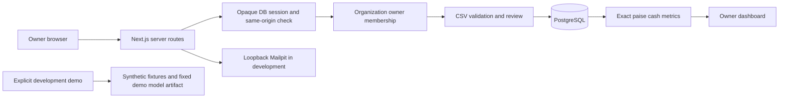
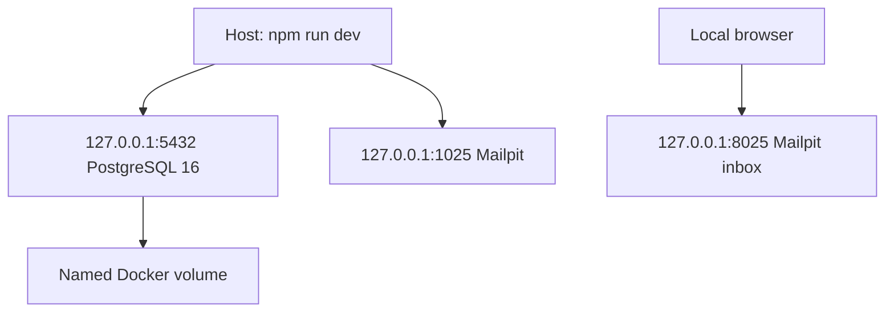
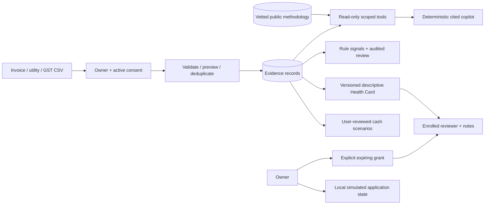

# Finnese 2.0 — implemented foundation

The existing FinesseAI design and Next.js App Router remain. Next.js was upgraded from 14.2.16 to 15.5.29 because the dependency audit found unresolved vulnerabilities on the 14.x line. React remains 18. Fonts are bundled locally under their upstream licenses instead of fetched during builds.

`db/migrations/001_foundation.sql` establishes the foundation; additive migrations 002–004 extend it. The migration runner uses an advisory transaction lock, ordered files and checksums. It refuses modifications to already-applied migrations. SQL is parameterized; foreign keys and account/fingerprint uniqueness enforce record integrity. `pg` is the production driver; no process-local business/session store is used by the owner workflow. SQL migrations were chosen over an ORM to keep financial constraints and transactional locks explicit in this limited slice.

OTP requests store an HMAC verifier, expiry and attempt counter. Verification locks the challenge, commits failed attempts, consumes valid challenges, creates a random opaque session and stores only its hash. Local Mailpit is the only implemented transport and is refused outside `NODE_ENV=development`.

Every business read/write checks organization owner membership on the server. Import confirmation locks the business, inserts deduplicated records and source evidence, records feature snapshots and marks the import complete atomically. Retrying confirmation returns its previous result. Preview is persisted and accessible by import ID; progress is a finite SSE replay of validated/completed milestones. This bounded synchronous importer is limited to 1,000 rows; it is not a background job queue.

Consent is explicit at preview, versioned, expires after 90 days and is checked at confirmation and data access. Revoked/expired records are excluded from current metrics and exports. Revocation removes feature snapshots for the business. Business deletion cascades its financial data; only a non-identifying deletion action remains in the audit trail.

Compose runs the infrastructure; the app runs on the host. Production still builds as a standalone Next.js container, but requires external PostgreSQL, a production auth transport, HTTPS, managed secrets, encrypted disks/backups and the reviews listed in SECURITY_AND_PRIVACY.md. The former stateless/no-database deployment instructions are historical. No deployment was performed.

PGlite is a **test-only** PostgreSQL engine used to run the same migration SQL and a local wire-protocol smoke test when Docker is absent. It is not a production database replacement or evidence of multi-instance load testing.

## Evidence and decision-support extension

`002_evidence.sql` stores immutable normalized alternate-source facts, previews, assessments and reconciliation reviews. `003_analysis.sql` stores alert reviews, scenarios and a vetted public full-text knowledge collection. `004_lending_sandbox.sql` stores grants, illustrative application terms and reviewer notes. All are parameterized SQL; mutations lock the business to serialize with consent and sharing changes. Current record reads filter active source consent. Derived history/scenarios require all originating record IDs to remain authorized.

`/api/intelligence`, `/api/analysis`, `/api/lending` authenticate server sessions; mutation routes enforce same origin, bounded Zod bodies and rate limits. Owners cannot assign themselves reviewer roles through public APIs. A development-only CLI enrolls fictional existing users. Reviewer role still requires a separate active grant for each business; admin role does not bypass this grant.

The local copilot selects from fixed read-only finance functions and PostgreSQL full-text retrieval. It does not execute generated SQL, arbitrary tools, uploaded instructions or external LLM calls. The lending sandbox records local state and never transmits an application. No OCEN/ULI protocol compatibility is asserted.

Offline synthetic evaluation writes content-addressed candidate JSON under `artifacts/models`; online demo inference continues to use its separately committed, schema-checked legacy artifact. Candidate creation does not publish a production model.

## Local completion extension

Owner-only export and saved-import resume use the same locked membership/active-consent boundary. `/api/intelligence/jobs` returns a saved preview or finite SSE status; it does not claim a streaming background queue. `/api/intelligence/reconcile` provides review-only configurable matching without changing source records or saved scores. `/api/businesses/export` emits scoped JSON.

The offline retention operator task defaults to dry-run and applies one transaction, preserving active facts while clearing expired-source content and potentially dependent business notes/history. No public retention endpoint exists. Scheduling remains an operational deployment concern.

Offline model workflows are separate: legacy app demo artifact; content-addressed synthetic candidate registry with explicit selection/rollback; and checksum-pinned licensed historical practice evaluation. Historical consumer-credit models never enter application scoring or the demo registry. The finite browser-test harness uses isolated ephemeral database state, fixture-only reviewer enrollment before app startup, and terminates its own processes afterward.
